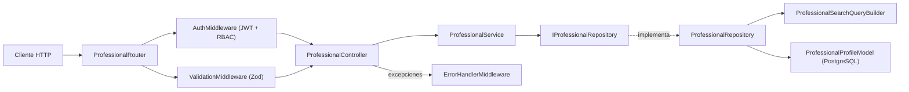

# Documentación Técnica — Módulo de Prestadores (Professionals)

Este documento describe la arquitectura, diseño de datos, contratos de validación, endpoints REST, integraciones inter-módulos y estrategia de pruebas del backend correspondiente al dominio de **Prestadores** (`src/modules/professionals/`) dentro de la API **Fixer**.

---

## 1. Alcance y Responsabilidades

El módulo de Prestadores encapsula la gestión integral de los perfiles profesionales (*Fixers*) registrados en la plataforma. Está montado bajo el prefijo `/api/v1/professionals` en [app.ts](file:///home/alejandro/Programacion/UTN/Fixer/src/app.ts#L109) y cubre las siguientes capacidades:

- Búsqueda pública paginada con filtrado multi-criterio (texto libre, oficio, zona/ciudad, verificación, disponibilidad de urgencias, calificación mínima) y ordenamiento dinámico.
- Consulta pública del detalle completo de un prestador, incluyendo sus datos de usuario y reseñas ordenadas cronológicamente.
- Consulta y actualización autenticada del perfil propio del prestador (protegida por JWT y control de acceso basado en roles).
- Construcción fluida de entidades de perfil y consultas complejas mediante el patrón creacional **Builder**.
- Recálculo consistente de promedio de calificación y desglose por estrellas ante nuevas reseñas.

---

## 2. Arquitectura Interna y Estructura de Archivos

El módulo sigue una arquitectura modular en capas basada en **POO**, principios **SOLID** y **Clean Code**:

```text
src/modules/professionals/
├── builders/
│   ├── ProfessionalProfileBuilder.ts       # Builder fluido para creación de perfiles
│   ├── ProfessionalSearchQueryBuilder.ts   # Builder dinámico de consultas Sequelize
│   └── index.ts                            # Barrel export de builders
├── controllers/
│   └── ProfessionalController.ts           # Adaptador HTTP (Request -> Service -> ApiResponseHelper)
├── dtos/
│   └── ProfessionalDTOs.ts                 # Esquemas Zod y tipos inferidos (Search y Update)
├── interfaces/
│   └── IProfessionalRepository.ts          # Contrato ISP/DIP del repositorio y tipos de búsqueda
├── models/
│   └── ProfessionalProfileModel.ts         # Modelo ORM Sequelize (tabla professional_profiles)
├── repositories/
│   └── ProfessionalRepository.ts           # Implementación Sequelize de IProfessionalRepository
├── routes/
│   └── ProfessionalRouter.ts               # Definición de rutas Express y middlewares
└── services/
    └── ProfessionalService.ts              # Casos de uso y reglas de negocio de prestadores
```

### Flujo de Ejecución de Peticiones



### Principios SOLID y Patrones Aplicados

| Principio / Patrón | Implementación en el Módulo | Beneficio Técnico |
| :--- | :--- | :--- |
| **SRP** | Separación estricta entre `ProfessionalRouter`, `ProfessionalController`, `ProfessionalService`, `ProfessionalRepository` y `ProfessionalProfileModel`. | Cada clase tiene una única razón de cambio (HTTP, negocio, consulta SQL o esquema). |
| **ISP / DIP** | `ProfessionalService` (y otros servicios como `ReviewService` y `ServiceRequestService`) dependen de `IProfessionalRepository`, no de la clase concreta `ProfessionalRepository`. | Permite inyectar implementaciones alternativas o repositorios en memoria en pruebas de integración y unitarias. |
| **Builder (Entidad)** | `ProfessionalProfileBuilder` ([ProfessionalProfileBuilder.ts](file:///home/alejandro/Programacion/UTN/Fixer/src/modules/professionals/builders/ProfessionalProfileBuilder.ts)) | Evita constructores extensos para los más de 20 atributos del perfil y centraliza defaults seguros para seeders, fábrica de cuentas y tests. |
| **Builder (Consulta)** | `ProfessionalSearchQueryBuilder` ([ProfessionalSearchQueryBuilder.ts](file:///home/alejandro/Programacion/UTN/Fixer/src/modules/professionals/builders/ProfessionalSearchQueryBuilder.ts)) | Aísla la construcción dinámica de filtros `Op.iLike` / `Op.or` / `Op.and` / `Op.gte`, joins, ordenamientos y paginación de Sequelize. |

---

## 3. Modelo de Datos y Relaciones

### Entidad `ProfessionalProfileModel`

Definida en [ProfessionalProfileModel.ts](file:///home/alejandro/Programacion/UTN/Fixer/src/modules/professionals/models/ProfessionalProfileModel.ts), mapea a la tabla `professional_profiles` con `timestamps: true` y `underscored: true` (configuración global en [DatabaseConnection.ts](file:///home/alejandro/Programacion/UTN/Fixer/src/database/DatabaseConnection.ts#L27-L30)).

| Atributo TS | Tipo Sequelize | Nulable | Default (Modelo ORM) | Default (`ProfessionalProfileBuilder`) | Descripción |
| :--- | :--- | :---: | :--- | :--- | :--- |
| `id` | `UUID` (`UUIDV4`, PK) | No | Auto UUIDv4 | Generado por DB | Identificador único del perfil profesional. |
| `userId` | `UUID` (Unique, FK `users.id`, `ON DELETE CASCADE`) | No | — | Requerido (`buildData()` valida) | Usuario propietario de la cuenta profesional. |
| `tradeCategory` | `STRING(80)` | No | — | `'servicios-generales'` | Categoría o rubro principal (ej. `plomeria`, `electricidad`). |
| `headline` | `STRING(200)` | No | — | `'Profesional Fixer'` | Titular comercial o especialidad visible en tarjetas. |
| `bio` | `TEXT` | No | — | Texto descriptivo base | Reseña profesional detallada del prestador. |
| `licenseNumber` | `STRING(100)` | No | — | `'En proceso de validación'` | Número de matrícula o certificación oficial. |
| `experienceYears` | `INTEGER` | No | `1` | `1` | Años de experiencia declarados. |
| `city` | `STRING(100)` | No | — | `'Buenos Aires'` | Ciudad base de operación. |
| `zone` | `STRING(120)` | No | — | `'Cobertura a coordinar'` | Zona o barrios de cobertura principal. |
| `address` | `STRING(200)` | No | — | `'Consultar cobertura'` | Dirección comercial o referencia de ubicación. |
| `coverageRadiusKm` | `INTEGER` | Sí | `25` | `15` | Radio de cobertura geográfica en kilómetros. |
| `responseTime` | `STRING(60)` | Sí | `'< 30 min'` | `'< 30 min'` | Tiempo estimado de respuesta. |
| `isEmergencyAvailable` | `BOOLEAN` | Sí | `true` | `false` | Disponibilidad inmediata para urgencias en el día. |
| `isVerified` | `BOOLEAN` | Sí | `true` | `false` | Indicador de validación/verificación oficial. |
| `badgeLevel` | `STRING(50)` | Sí | `'Verificado Fixer'` | `'Nuevo Profesional'` | Insignia de nivel/reputación mostrada en perfil. |
| `ratingAverage` | `DECIMAL(3, 2)` | Sí | `5.0` | `5.0` | Promedio acumulado de calificaciones (1.00 a 5.00). |
| `totalReviews` | `INTEGER` | Sí | `0` | `0` | Cantidad total de reseñas recibidas. |
| `fiveStarCount` .. `oneStarCount` | `INTEGER` | Sí | `0` | `0` | Contadores desagregados de reseñas por cantidad de estrellas (5 a 1). |
| `specialties` | `JSONB` (`string[]`) | Sí | `[]` | `[]` | Lista de especialidades técnicas del prestador. |

> [!NOTE]
> El modelo Sequelize define valores por defecto orientados a perfiles base (`coverageRadiusKm: 25`, `isEmergencyAvailable: true`, `isVerified: true`), mientras que `ProfessionalProfileBuilder` inicializa cuentas nuevas con valores conservadores (`isVerified: false`, `isEmergencyAvailable: false`, `badgeLevel: 'Nuevo Profesional'`), garantizando que un profesional recién registrado no aparezca como verificado automáticamente.

### Índices y Asociaciones Relacionales

- **Índices de tabla** (`professional_profiles`): `trade_category`, `city`, `zone`, `is_verified`, `is_emergency_available`, `rating_average`, además de índice único sobre `user_id`.
- **Asociaciones** configuradas en [ModelRegistry.ts](file:///home/alejandro/Programacion/UTN/Fixer/src/database/ModelRegistry.ts#L18-L66):
  - `UserModel` **1:1** `ProfessionalProfileModel` (`as: 'professionalProfile'` / `as: 'user'`, FK `userId`).
  - `ProfessionalProfileModel` **1:N** `ReviewModel` (`as: 'reviews'`, FK `professionalId`).
  - `ProfessionalProfileModel` **1:N** `ServiceRequestModel` (`as: 'assignedRequests'`, FK `professionalId`).

---

## 4. Contratos de Validación (DTOs con Zod)

Definidos en [ProfessionalDTOs.ts](file:///home/alejandro/Programacion/UTN/Fixer/src/modules/professionals/dtos/ProfessionalDTOs.ts) y ejecutados por [ValidationMiddleware.ts](file:///home/alejandro/Programacion/UTN/Fixer/src/common/middlewares/ValidationMiddleware.ts):

### 4.1 `SearchProfessionalsSchema` (`GET /api/v1/professionals`)

Valida y coerciona los parámetros de `req.query` (que llegan como `string` desde HTTP):

| Campo | Validación y Transformación | Valor por defecto |
| :--- | :--- | :--- |
| `query` | `string().optional()` | `undefined` |
| `category` | `string().optional()` | `undefined` |
| `zone` | `string().optional()` | `undefined` |
| `city` | `string().optional()` | `undefined` |
| `isVerified` | `'true'` -> `true`; cualquier otro string -> `false`; ausente -> `undefined` | `undefined` |
| `isEmergencyAvailable` | `'true'` -> `true`; cualquier otro string -> `false`; ausente -> `undefined` | `undefined` |
| `minRating` | `Number(val)` si está presente | `undefined` |
| `sortBy` | `z.enum(['rating', 'urgency', 'experience'])` | `'rating'` |
| `page` | `Math.max(Number(val), 1)` | `1` |
| `limit` | `Math.max(Number(val), 1)` | `12` |

### 4.2 `UpdateProfessionalProfileSchema` (`PUT /api/v1/professionals/me`)

Valida actualizaciones parciales en `req.body`. Todos los campos son opcionales:

- `tradeCategory`: `string().min(2)`
- `headline`: `string().min(5)`
- `bio`: `string().min(10)`
- `licenseNumber`: `string()`
- `experienceYears`: `number().int().min(0)`
- `city`, `zone`, `address`, `responseTime`: `string()`
- `coverageRadiusKm`: `number().int().min(1)`
- `isEmergencyAvailable`: `boolean()`
- `specialties`: `z.array(z.string())`

Por diseño de seguridad, Zod descarta cualquier propiedad no declarada en el esquema, impidiendo que un prestador modifique por esta vía campos de reputación o administrativos (`isVerified`, `badgeLevel`, `ratingAverage`, `totalReviews`, contadores de estrellas o `userId`).

---

## 5. Construcción de Consultas y Repositorio

### `ProfessionalSearchQueryBuilder`

`ProfessionalSearchQueryBuilder.fromFilters(filters)` encadena los filtros en el siguiente orden:
1. `filterByText(query)`: aplica `Op.or` insensible a mayúsculas (`Op.iLike`) sobre `user.full_name` (vía `Sequelize.col('user.full_name')`), `headline`, `bio`, `tradeCategory` y `licenseNumber`. Si `whereClause[Op.or]` ya existía previamente, combina ambas condiciones mediante `Op.and`.
2. `filterByCategory(category)`: filtra `tradeCategory` con `Op.iLike`.
3. `filterByZone(zone, city)`: si `zone` tiene contenido, busca coincidencias `Op.iLike` en `zone`, `city` o `address` mediante `Op.or`; si solo se envía `city`, filtra únicamente sobre `city`.
4. `onlyVerified(isVerified)` y `onlyAvailableToday(isEmergencyAvailable)`: aplican filtro booleano exacto cuando el valor no es `undefined`.
5. `filterByMinRating(minRating)`: aplica `ratingAverage >= minRating` (`Op.gte`).
6. `sortBy(sortBy)`:
   - `'urgency'`: `[['isEmergencyAvailable', 'DESC'], ['ratingAverage', 'DESC']]`
   - `'experience'`: `[['experienceYears', 'DESC']]`
   - `'rating'` (default): `[['ratingAverage', 'DESC'], ['totalReviews', 'DESC']]`
7. `paginate(page, limit)`: garantiza mínimos de `page >= 1` y `limit >= 1`, calculando `offset = (page - 1) * limit`.
8. `build()`: retorna las opciones Sequelize con `include` del `UserModel` (`['id', 'fullName', 'email', 'phone', 'avatarUrl']`), `subQuery: false` (necesario para filtrar por `user.full_name` en la consulta principal) y `distinct: true`.

> [!IMPORTANT]
> **Consideración técnica en `fromFilters`**: dado que `fromFilters` invoca `filterByText` antes que `filterByZone`, si una consulta envía simultáneamente `query` y `zone`, la asignación `this.whereClause[Op.or] = [...]` dentro de `filterByZone` sobrescribe la clave `Op.or` previa de `filterByText`. Si se requiere combinar texto y zona sin pérdida, debe invocarse `filterByZone` antes que `filterByText` (o agrupar ambos bloques en `Op.and` dentro de `filterByZone`).

### `ProfessionalRepository`

Implementa `IProfessionalRepository` ([ProfessionalRepository.ts](file:///home/alejandro/Programacion/UTN/Fixer/src/modules/professionals/repositories/ProfessionalRepository.ts)):

- `findById(id)` y `findByUserId(userId)`: incluyen la relación `user` con atributos públicos (`id`, `fullName`, `email`, `phone`, `avatarUrl`, `role`).
- `findByIdWithDetails(id)`: además de `user`, incluye `reviews` con `separate: true`, orden `[['createdAt', 'DESC']]` y el autor `client` (`id`, `fullName`, `avatarUrl`).
- `search(filters)`: ejecuta `ProfessionalProfileModel.findAndCountAll` con las opciones del builder y devuelve `IProfessionalSearchResult` (`professionals`, `total`, `totalPages: Math.ceil(count / limit)`, `page`, `limit`).
- `recalculateRatings(professionalId)`: consulta todas las calificaciones en `ReviewModel` para el `professionalId`. Si no hay reseñas, restablece `ratingAverage: 5.0` y todos los contadores a `0`; en caso contrario, computa la distribución de 1 a 5 estrellas y `ratingAverage` redondeado a 2 decimales (`Number((sum / totalReviews).toFixed(2))`).

---

## 6. Catálogo de Endpoints REST (`/api/v1/professionals`)

Las rutas se declaran en [ProfessionalRouter.ts](file:///home/alejandro/Programacion/UTN/Fixer/src/modules/professionals/routes/ProfessionalRouter.ts). **El orden de registro es crítico**: `GET /me` y `PUT /me` se registran antes que `GET /:id` para evitar que Express interprete el segmento literal `me` como parámetro `:id`.

| Método y Ruta | Acceso / Middlewares | Caso de Uso (`ProfessionalService`) | Respuesta Exitosa | Errores Posibles |
| :--- | :--- | :--- | :--- | :--- |
| `GET /api/v1/professionals` | Público<br>`validateQuery(SearchProfessionalsSchema)` | `search(filters)` | `200 OK` paginado (`data` + `meta: { page, limit, total, totalPages }`) | `422` si query params son inválidos (ej. `sortBy` no soportado) |
| `GET /api/v1/professionals/me` | JWT requerido (`authenticate`)<br>RBAC: `PROFESSIONAL`, `ADMIN` | `getProfileByUserId(req.user.id)` | `200 OK` con perfil y usuario asociado | `401` sin token o token inválido<br>`403` rol `CLIENT`<br>`404` usuario sin perfil |
| `PUT /api/v1/professionals/me` | JWT requerido (`authenticate`)<br>RBAC: `PROFESSIONAL`, `ADMIN`<br>`validateBody(UpdateProfessionalProfileSchema)` | `updateMyProfile(req.user.id, req.body)` | `200 OK` con el perfil actualizado | `401` sin token o inválido<br>`403` rol `CLIENT`<br>`404` perfil inexistente<br>`422` body inválido |
| `GET /api/v1/professionals/:id` | Público | `getProfileById(req.params.id)` | `200 OK` con perfil, usuario y `reviews` | `404` si el perfil no existe |

Todos los métodos del controlador están envueltos con `AsyncHandler.wrap`, delegando cualquier `AppError` (`UnauthorizedError`, `ForbiddenError`, `NotFoundError`, `ValidationError`) al manejador global [ErrorHandlerMiddleware.ts](file:///home/alejandro/Programacion/UTN/Fixer/src/common/middlewares/ErrorHandlerMiddleware.ts).

---

## 7. Integración con Otros Módulos del Backend

El módulo de Prestadores interactúa con otros tres dominios del sistema:

1. **Registro de Cuentas (`auth` + `AccountFactory`)**:
   - Cuando un usuario se registra con `isPro: true` en [AuthService.ts](file:///home/alejandro/Programacion/UTN/Fixer/src/modules/auth/services/AuthService.ts#L52-L57), `AccountFactory` resuelve `ProfessionalAccountCreator` ([AccountFactory.ts](file:///home/alejandro/Programacion/UTN/Fixer/src/common/factories/AccountFactory.ts#L53-L89)), que crea el `UserModel` con rol `'PROFESSIONAL'` y construye automáticamente su `ProfessionalProfileModel` inicial mediante `ProfessionalProfileBuilder`.
2. **Reseñas y Reputación (`reviews`)**:
   - [ReviewService.ts](file:///home/alejandro/Programacion/UTN/Fixer/src/modules/reviews/services/ReviewService.ts#L22-L45) verifica mediante `IProfessionalRepository.findById` que el prestador exista y bloquea que el usuario se califique a sí mismo (`professional.userId === clientId` -> `BadRequestError`). Tras persistir la reseña, invoca `professionalRepository.recalculateRatings(dto.professionalId)` para mantener consistentes `ratingAverage` y los contadores por estrella.
3. **Solicitudes de Servicio (`service-requests`)**:
   - [ServiceRequestService.ts](file:///home/alejandro/Programacion/UTN/Fixer/src/modules/service-requests/services/ServiceRequestService.ts#L24-L49) valida la existencia del prestador (`findById`), impide auto-solicitudes (`professional.userId === clientId`), y resuelve la bandeja de órdenes asignadas (`getMyRequestsAsProfessional`) traduciendo el `userId` del token al `profile.id` mediante `findByUserId`.

---

## 8. Pruebas Automatizadas del Módulo

Las pruebas utilizan el runner nativo de Node.js (`tsx --test`) y se ejecutan con `pnpm test` sin requerir una instancia externa de PostgreSQL:

- **Pruebas unitarias de patrones creacionales**: [creational-patterns.test.ts](file:///home/alejandro/Programacion/UTN/Fixer/src/__tests__/creational-patterns.test.ts) — verifica la construcción fluida y defaults de `ProfessionalProfileBuilder` y las cláusulas base de `ProfessionalSearchQueryBuilder`.
- **Pruebas unitarias de dominio y capas**: [professionals.unit.test.ts](file:///home/alejandro/Programacion/UTN/Fixer/src/__tests__/professionals.unit.test.ts) — cubre coerción y reglas Zod en DTOs, casos borde en builders, lógica de negocio y manejo de `NotFoundError` en `ProfessionalService`, cálculo de paginación y `recalculateRatings` en `ProfessionalRepository`, y guardas/formateo en `ProfessionalController`.
- **Pruebas de integración HTTP e inter-módulo**: [professionals.integration.test.ts](file:///home/alejandro/Programacion/UTN/Fixer/src/__tests__/professionals.integration.test.ts) — levanta el enrutador real `ProfessionalRouter` sobre Express con `AuthMiddleware` (JWT + RBAC), `ValidationMiddleware`, `ErrorHandlerMiddleware` y un repositorio en memoria con estado, verificando búsqueda filtrada, detalle público, precedencia `/me` vs `/:id`, autorización por roles, flujo `PUT /me` -> `GET /:id`, y el recálculo de reputación disparado desde `ReviewService`.
