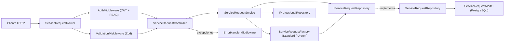

# Documentación Técnica — Módulo de Solicitudes de Servicio (Service Requests)

Este documento describe la arquitectura, diseño de datos, contratos de validación, patrón creacional *Factory Method*, endpoints REST, integraciones inter-módulos y estrategia de pruebas del backend correspondiente al dominio de **Solicitudes de Servicio** (`src/modules/service-requests/`) dentro de la API **Fixer**.

---

## 1. Alcance y Responsabilidades

El módulo de Solicitudes de Servicio encapsula el ciclo de vida completo de las órdenes de trabajo y cotizaciones emitidas por clientes hacia los profesionales (*Fixers*) registrados en la plataforma. Está montado bajo el prefijo `/api/v1/service-requests` en [app.ts](file:///home/alejandro/Programacion/UTN/Fixer/src/app.ts#L143) y cubre las siguientes capacidades:

- Creación autenticada de solicitudes de servicio tanto **estándar** como de **urgencia** mediante el patrón creacional **Factory Method**.
- Validación de reglas de dominio al emitir una orden (existencia del profesional destinatario y prohibición de auto-solicitudes).
- Consulta autenticada de la bandeja de solicitudes enviadas por el cliente (`/client/my-requests`).
- Consulta autenticada y protegida por RBAC (`PROFESSIONAL`, `ADMIN`) de la bandeja de órdenes asignadas al profesional (`/pro/my-requests`).
- Gestión de la máquina de estados de la orden (`PENDING`, `ACCEPTED`, `IN_PROGRESS`, `COMPLETED`, `CANCELLED`) con control de pertenencia (solo cliente emisor o profesional asignado) y persistencia del motivo de cancelación (`cancellationReason`).

---

## 2. Arquitectura Interna y Estructura de Archivos

El módulo sigue una arquitectura modular en capas basada en **POO**, principios **SOLID** y **Clean Code**:

```text
src/modules/service-requests/
├── controllers/
│   └── ServiceRequestController.ts         # Adaptador HTTP (Request -> Service -> ApiResponseHelper)
├── dtos/
│   └── ServiceRequestDTOs.ts               # Esquemas Zod y tipos inferidos (Create y UpdateStatus)
├── factories/
│   ├── ServiceRequestFactory.ts            # Patrón Factory Method (Standard vs Urgent creators)
│   └── index.ts                            # Barrel export de factories
├── interfaces/
│   └── IServiceRequestRepository.ts        # Contrato ISP/DIP del repositorio de solicitudes
├── models/
│   └── ServiceRequestModel.ts              # Modelo ORM Sequelize (tabla service_requests)
├── repositories/
│   └── ServiceRequestRepository.ts         # Implementación Sequelize de IServiceRequestRepository
├── routes/
│   └── ServiceRequestRouter.ts             # Definición de rutas Express, middlewares y Swagger
└── services/
    └── ServiceRequestService.ts            # Casos de uso y reglas de negocio de órdenes de servicio
```

### Flujo de Ejecución de Peticiones



### Principios SOLID y Patrones Aplicados

| Principio / Patrón | Implementación en el Módulo | Beneficio Técnico |
| :--- | :--- | :--- |
| **SRP** | Separación estricta entre `ServiceRequestRouter`, `ServiceRequestController`, `ServiceRequestService`, `ServiceRequestFactory`, `ServiceRequestRepository` y `ServiceRequestModel`. | Cada clase posee una única razón de cambio (transporte HTTP, reglas de negocio, instanciación polimórfica, acceso a datos o esquema ORM). |
| **OCP** | Jerarquía `ServiceRequestCreator` con subclases `StandardServiceRequestCreator` y `UrgentServiceRequestCreator`. | Permite incorporar nuevas variantes de solicitudes (ej. programadas recurrentes o corporativas) extendiendo `ServiceRequestCreator` sin modificar la lógica de `ServiceRequestService`. |
| **ISP / DIP** | `ServiceRequestService` depende de las abstracciones `IServiceRequestRepository` e `IProfessionalRepository`, no de implementaciones Sequelize concretas. | Facilita la inyección de stubs y repositorios en memoria para pruebas unitarias y de integración sin acoplamiento a PostgreSQL. |
| **Factory Method** | `ServiceRequestFactory` y `ServiceRequestCreator` ([ServiceRequestFactory.ts](file:///home/alejandro/Programacion/UTN/Fixer/src/modules/service-requests/factories/ServiceRequestFactory.ts)) | Encapsula las diferencias de construcción entre órdenes estándar y urgencias (prefijo `[URGENTE]`, flag `isUrgent`, `scheduledDate` inmediata y estado inicial `'PENDING'`). |

---

## 3. Modelo de Datos y Relaciones

### Entidad `ServiceRequestModel`

Definida en [ServiceRequestModel.ts](file:///home/alejandro/Programacion/UTN/Fixer/src/modules/service-requests/models/ServiceRequestModel.ts), mapea a la tabla `service_requests` con `timestamps: true` y `underscored: true` (configuración global en [DatabaseConnection.ts](file:///home/alejandro/Programacion/UTN/Fixer/src/database/DatabaseConnection.ts#L27-L30)).

| Atributo TS | Tipo Sequelize | Nulable | Default (Modelo ORM) | Default (`Standard` / `Urgent` Creator) | Descripción |
| :--- | :--- | :---: | :--- | :--- | :--- |
| `id` | `UUID` (`UUIDV4`, PK) | No | Auto UUIDv4 | Generado por DB | Identificador único de la solicitud de servicio. |
| `clientId` | `UUID` (FK `users.id`, `ON DELETE CASCADE`) | No | — | `req.user.id` | Usuario cliente que emite la solicitud. |
| `professionalId` | `UUID` (FK `professional_profiles.id`, `ON DELETE CASCADE`) | No | — | `dto.professionalId` | Perfil profesional destinatario del trabajo. |
| `title` | `STRING(150)` | No | — | `dto.title` / `[URGENTE] ${dto.title}` | Título descriptivo corto del requerimiento. |
| `description` | `TEXT` | No | — | `dto.description` | Descripción detallada del problema o servicio. |
| `category` | `STRING(80)` | No | — | `dto.category` | Rubro u oficio asociado a la solicitud. |
| `serviceAddress` | `STRING(200)` | No | — | `dto.serviceAddress` | Domicilio donde debe ejecutarse el servicio. |
| `zone` | `STRING(100)` | No | — | `dto.zone` | Barrio o zona geográfica del domicilio. |
| `isUrgent` | `BOOLEAN` | No | `false` | `false` (Standard) / `true` (Urgent) | Indica si requiere atención de emergencia inmediata. |
| `scheduledDate` | `DATE` | Sí | `null` | `dto.scheduledDate \|\| null` / `new Date()` | Fecha pactada o timestamp inmediato en urgencias. |
| `status` | `ENUM('PENDING', 'ACCEPTED', 'IN_PROGRESS', 'COMPLETED', 'CANCELLED')` | No | `'PENDING'` | `'PENDING'` | Estado actual dentro del ciclo de vida de la orden. |
| `cancellationReason` | `TEXT` | Sí | `null` | `null` | Motivo registrado al cancelar o actualizar la orden. |

> [!NOTE]
> `UrgentServiceRequestCreator` verifica si `dto.title` ya comienza con `[URGENTE]` antes de concatenar el prefijo (`dto.title.startsWith('[URGENTE]') ? dto.title : '[URGENTE] ' + dto.title`), garantizando idempotencia en el formateo del título y asignando `new Date()` a `scheduledDate` cuando el cliente no especifica una fecha.

### Índices y Asociaciones Relacionales

- **Índices de tabla** (`service_requests`): `client_id`, `professional_id`, `status` e `is_urgent`.
- **Asociaciones** configuradas en [ModelRegistry.ts](file:///home/alejandro/Programacion/UTN/Fixer/src/database/ModelRegistry.ts#L48-L66):
  - `UserModel` **1:N** `ServiceRequestModel` (`as: 'serviceRequests'` / `as: 'client'`, FK `clientId`).
  - `ProfessionalProfileModel` **1:N** `ServiceRequestModel` (`as: 'assignedRequests'` / `as: 'professional'`, FK `professionalId`).

---

## 4. Contratos de Validación (DTOs con Zod)

Definidos en [ServiceRequestDTOs.ts](file:///home/alejandro/Programacion/UTN/Fixer/src/modules/service-requests/dtos/ServiceRequestDTOs.ts) y ejecutados por [ValidationMiddleware.ts](file:///home/alejandro/Programacion/UTN/Fixer/src/common/middlewares/ValidationMiddleware.ts):

### 4.1 `CreateServiceRequestSchema` (`POST /api/v1/service-requests`)

Valida y transforma el payload de creación en `req.body`:

| Campo | Validación y Transformación | Valor por defecto |
| :--- | :--- | :--- |
| `professionalId` | `z.string().uuid('ID de profesional inválido')` | Requerido |
| `title` | `z.string().min(5, 'El título del requerimiento debe tener al menos 5 caracteres')` | Requerido |
| `description` | `z.string().min(10, 'Describe con mayor detalle el problema o servicio requerido')` | Requerido |
| `category` | `z.string().min(2, 'La categoría del servicio es requerida')` | Requerido |
| `serviceAddress` | `z.string().min(5, 'La dirección del servicio es requerida')` | Requerido |
| `zone` | `z.string().min(2, 'La zona o barrio es requerido')` | Requerido |
| `isUrgent` | `z.boolean().default(false)` | `false` |
| `scheduledDate` | `z.string().optional().transform((val) => (val ? new Date(val) : undefined))` | `undefined` |

### 4.2 `UpdateRequestStatusSchema` (`PATCH /api/v1/service-requests/:id/status`)

Valida la transición de estado en `req.body`:

- `status`: `z.enum(['PENDING', 'ACCEPTED', 'IN_PROGRESS', 'COMPLETED', 'CANCELLED'])` (requerido).
- `reason`: `z.string().optional()` (motivo opcional asociado al cambio de estado o cancelación).

---

## 5. Patrón Factory Method y Repositorio

### `ServiceRequestFactory` y `ServiceRequestCreator`

Definidos en [ServiceRequestFactory.ts](file:///home/alejandro/Programacion/UTN/Fixer/src/modules/service-requests/factories/ServiceRequestFactory.ts), implementan el patrón creacional **Factory Method**:

1. `ServiceRequestFactory.getCreator(dto.isUrgent)` devuelve una instancia de `UrgentServiceRequestCreator` cuando `isUrgent` es `true`, o `StandardServiceRequestCreator` en caso contrario.
2. `creator.create(repository, clientId, dto)` invoca al método plantilla `buildCreationAttributes(clientId, dto)` y persiste los atributos resultantes mediante `repository.create(attributes)`:
   - **`StandardServiceRequestCreator`**: fija `isUrgent: false`, `scheduledDate: dto.scheduledDate || null` y `status: 'PENDING'`.
   - **`UrgentServiceRequestCreator`**: fija `isUrgent: true`, antepone `[URGENTE]` al título si no lo posee, asigna `scheduledDate: dto.scheduledDate || new Date()` y `status: 'PENDING'`.

### `ServiceRequestRepository`

Implementa `IServiceRequestRepository` ([ServiceRequestRepository.ts](file:///home/alejandro/Programacion/UTN/Fixer/src/modules/service-requests/repositories/ServiceRequestRepository.ts)):

- `findById(id)`: recupera una solicitud por PK incluyendo la relación `client` (`id`, `fullName`, `email`, `phone`, `avatarUrl`) y la relación anidada `professional` -> `user` (`id`, `fullName`, `email`, `phone`, `avatarUrl`).
- `findByClientId(clientId)`: lista las órdenes creadas por un cliente ordenadas por `[['createdAt', 'DESC']]`, incluyendo `professional` y su `user` (`id`, `fullName`, `phone`).
- `findByProfessionalId(professionalId)`: lista las órdenes asignadas a un perfil profesional ordenadas por `[['createdAt', 'DESC']]`, incluyendo los datos de contacto del `client` (`id`, `fullName`, `email`, `phone`, `avatarUrl`).
- `updateStatus(id, status, reason?)`: busca el registro por PK; si no existe retorna `null`. Si existe, actualiza `status` y conserva el motivo previo cuando no se envía uno nuevo (`cancellationReason: reason || request.cancellationReason`).

> [!IMPORTANT]
> **Control de acceso en `ServiceRequestService.updateStatus`**: antes de invocar a `requestRepository.updateStatus`, el servicio verifica que el usuario autenticado (`currentUserId`) sea o bien el cliente emisor (`request.clientId === currentUserId`) o bien el usuario propietario del perfil profesional asignado (`professional.userId === currentUserId`). Cualquier otro usuario autenticado recibe `ForbiddenError` (`403`).

---

## 6. Catálogo de Endpoints REST (`/api/v1/service-requests`)

Las rutas se declaran en [ServiceRequestRouter.ts](file:///home/alejandro/Programacion/UTN/Fixer/src/modules/service-requests/routes/ServiceRequestRouter.ts). Todas las rutas del módulo requieren autenticación JWT.

| Método y Ruta | Acceso / Middlewares | Caso de Uso (`ServiceRequestService`) | Respuesta Exitosa | Errores Posibles |
| :--- | :--- | :--- | :--- | :--- |
| `POST /api/v1/service-requests` | JWT requerido (`authenticate`)<br>`validateBody(CreateServiceRequestSchema)` | `createRequest(req.user.id, req.body)` | `201 Created` con la solicitud creada | `400` auto-solicitud<br>`401` sin token o inválido<br>`404` profesional no encontrado<br>`422` body inválido |
| `GET /api/v1/service-requests/client/my-requests` | JWT requerido (`authenticate`) | `getMyRequestsAsClient(req.user.id)` | `200 OK` con lista de solicitudes emitidas por el cliente | `401` sin token o token inválido |
| `GET /api/v1/service-requests/pro/my-requests` | JWT requerido (`authenticate`)<br>RBAC: `PROFESSIONAL`, `ADMIN` | `getMyRequestsAsProfessional(req.user.id)` | `200 OK` con lista de solicitudes asignadas al profesional | `401` sin token o inválido<br>`403` rol `CLIENT`<br>`404` perfil profesional no encontrado |
| `PATCH /api/v1/service-requests/:id/status` | JWT requerido (`authenticate`)<br>`validateBody(UpdateRequestStatusSchema)` | `updateStatus(req.params.id, req.user.id, req.body)` | `200 OK` con la solicitud actualizada | `401` sin token o inválido<br>`403` usuario ajeno a la orden<br>`404` solicitud no encontrada<br>`422` estado inválido |

Todos los métodos del controlador están envueltos con `AsyncHandler.wrap`, delegando cualquier `AppError` (`BadRequestError`, `UnauthorizedError`, `ForbiddenError`, `NotFoundError`, `ValidationError`) al manejador global [ErrorHandlerMiddleware.ts](file:///home/alejandro/Programacion/UTN/Fixer/src/common/middlewares/ErrorHandlerMiddleware.ts).

---

## 7. Integración con Otros Módulos del Backend

El módulo de Solicitudes de Servicio se integra directamente con los dominios de **Prestadores** y **Usuarios / Autenticación**:

1. **Módulo de Prestadores (`professionals`)**:
   - `ServiceRequestService` recibe `IProfessionalRepository` por inyección de dependencias en su constructor ([app.ts](file:///home/alejandro/Programacion/UTN/Fixer/src/app.ts#L100)).
   - En `createRequest`, utiliza `professionalRepository.findById(dto.professionalId)` para validar que el perfil destino exista (`NotFoundError` si no existe) y comprobar que `professional.userId !== clientId` (`BadRequestError` en auto-solicitud).
   - En `getMyRequestsAsProfessional`, traduce el `userId` del token JWT al `profile.id` mediante `professionalRepository.findByUserId(userId)`.
   - En `updateStatus`, consulta `professionalRepository.findById(request.professionalId)` para verificar si `professional.userId === currentUserId` al autorizar el cambio de estado.
2. **Módulo de Usuarios y Autenticación (`users` / `auth`)**:
   - `AuthMiddleware` valida el token JWT emitido por `TokenService`, adjunta `req.user` (`id`, `email`, `role`, `fullName`) y aplica control de roles (`authorize(['PROFESSIONAL', 'ADMIN'])`) en `/pro/my-requests`.
   - `ServiceRequestRepository` realiza `include` de `UserModel` (`as: 'client'` y `professional.user`) para enriquecer las bandejas del cliente y del profesional con datos de contacto.

---

## 8. Pruebas Automatizadas del Módulo

Las pruebas utilizan **Vitest** (`vitest run`) y se ejecutan con `pnpm test`, `pnpm run test:unit` y `pnpm run test:integration` sin requerir una instancia externa de PostgreSQL:

- **Pruebas unitarias de dominio y capas**: [service-requests.unit.test.ts](file:///home/alejandro/Programacion/UTN/Fixer/src/__tests__/unit/service-requests.unit.test.ts) — cubre las 7 pruebas unitarias clave del módulo:
  - **U1**: Validación de UUID y longitudes mínimas, default `isUrgent = false` y transformación de `scheduledDate` a `Date` en `CreateServiceRequestSchema`.
  - **U2**: Validación estricta del enum de estados permitidos y `reason` opcional en `UpdateRequestStatusSchema`.
  - **U3**: Selección polimórfica entre `StandardServiceRequestCreator` y `UrgentServiceRequestCreator` en `ServiceRequestFactory`, defaults e idempotencia del prefijo `[URGENTE]`.
  - **U4**: Reglas de dominio en `ServiceRequestService.createRequest()` (`NotFoundError` 404 ante profesional inexistente, `BadRequestError` 400 ante auto-solicitud y creación exitosa).
  - **U5**: Traducción `userId` -> `profile.id` y manejo de `NotFoundError` 404 en `ServiceRequestService.getMyRequestsAsProfessional()`.
  - **U6**: Control de pertenencia en `ServiceRequestService.updateStatus()` (autorización a cliente dueño y profesional asignado, bloqueo `ForbiddenError` 403 a terceros y `NotFoundError` 404 si no existe).
  - **U7**: Persistencia de estado, conservación de `cancellationReason` previa y retorno `null` en `ServiceRequestRepository.updateStatus()`.
- **Pruebas de integración HTTP e inter-módulo**: [service-requests.integration.test.ts](file:///home/alejandro/Programacion/UTN/Fixer/src/__tests__/integration/service-requests.integration.test.ts) — levanta el enrutador real `ServiceRequestRouter` sobre Express con `AuthMiddleware`, `ValidationMiddleware`, `ErrorHandlerMiddleware` y repositorios en memoria con estado, verificando:
  - **I1**: `POST /api/v1/service-requests` (autenticación JWT 401, validación Zod 422, bloqueo de auto-solicitud 400 y creación 201 de órdenes urgentes con `[URGENTE]` y `scheduledDate`).
  - **I2**: `GET /client/my-requests` y `GET /pro/my-requests` (bloqueo RBAC 403 para rol `CLIENT` en ruta profesional y aislamiento de bandejas por usuario).
  - **I3**: `PATCH /api/v1/service-requests/:id/status` (aceptación por el profesional asignado, cancelación con `cancellationReason` por el cliente dueño y bloqueo 403 a terceros).
