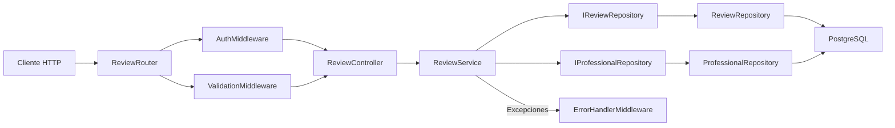

# Documentación Técnica — Módulo de Reseñas (Reviews)

Este documento describe la arquitectura, diseño de datos, contratos de validación, endpoints REST, integraciones inter-módulos y estrategia de pruebas del backend correspondiente al dominio de **Reseñas** (`src/modules/reviews/`) dentro de la API **Fixer**.

---

## 1. Alcance y Responsabilidades

El módulo de Reseñas gestiona las valoraciones que los usuarios realizan sobre los profesionales registrados en Fixer.

Está montado bajo el prefijo `/api/v1/reviews` y contempla las siguientes capacidades:

- Publicación de reseñas por usuarios autenticados.
- Calificación de profesionales mediante una puntuación de 1 a 5 estrellas.
- Consulta pública de reseñas asociadas a un profesional, con parámetros de paginación.
- Respuesta a reseñas por parte del profesional evaluado.
- Validación de existencia del profesional y prevención de reseñas sobre el perfil propio.
- Recálculo automático de las estadísticas de reputación después de publicar una reseña.

El módulo interactúa directamente con el dominio de Prestadores para consultar perfiles y mantener actualizadas sus valoraciones.

---

## 2. Arquitectura Interna y Estructura de Archivos

El módulo sigue una arquitectura modular en capas basada en **Programación Orientada a Objetos (POO)**, principios **SOLID** y separación de responsabilidades.

```text
src/modules/reviews/
├── controllers/
│   └── ReviewController.ts
├── dtos/
│   └── ReviewDTOs.ts
├── interfaces/
│   └── IReviewRepository.ts
├── models/
│   └── ReviewModel.ts
├── repositories/
│   └── ReviewRepository.ts
├── routes/
│   └── ReviewRouter.ts
└── services/
    └── ReviewService.ts
```

### Flujo de ejecución de peticiones



Las rutas públicas no requieren autenticación. Las operaciones de publicación y respuesta utilizan JWT, mientras que la respuesta a una reseña incorpora autorización por roles.

### Principios SOLID aplicados

| Principio | Implementación | Beneficio |
|---|---|---|
| SRP | Separación entre Router, Controller, Service y Repository | Cada capa tiene responsabilidades específicas |
| OCP | Servicios desacoplados de implementaciones concretas de repositorios | Permite extender implementaciones sin modificar la lógica del servicio |
| LSP | Uso de excepciones derivadas de `AppError` | Manejo uniforme de errores |
| ISP | Interfaces `IReviewRepository` e `IProfessionalRepository` | Contratos específicos para acceder a los datos |
| DIP | `ReviewService` recibe interfaces mediante su constructor | Facilita la sustitución por mocks en pruebas unitarias |

---

## 3. Modelo de Datos y Relaciones

### Entidad `ReviewModel`

Representa una reseña publicada por un usuario sobre un perfil profesional.

Los siguientes atributos se identifican en el código del servicio y los DTOs:

| Atributo | Tipo lógico | Descripción |
|---|---|---|
| `id` | Identificador | Identificador único de la reseña |
| `clientId` | Identificador | Usuario que publica la reseña |
| `professionalId` | UUID | Perfil profesional evaluado |
| `rating` | Entero | Calificación de 1 a 5 estrellas |
| `serviceType` | String | Tipo de servicio realizado |
| `comment` | String | Testimonio del usuario |
| `isVerifiedVisit` | Boolean | Indicador de visita verificada |
| `professionalReply` | String | Respuesta del profesional |
| `repliedAt` | Date | Fecha de respuesta |


### Relaciones con otras entidades

El módulo trabaja con dos entidades principales:

- **User:** identifica al autor de la reseña mediante `clientId`.
- **ProfessionalProfile:** identifica al profesional evaluado mediante `professionalId`.

Desde el módulo de Prestadores se establece una relación de uno a muchos entre `ProfessionalProfileModel` y `ReviewModel`.

```text
User
  │
  └── publica ──> Review
                    │
                    └── evalúa ──> ProfessionalProfile
```

Un profesional puede recibir múltiples reseñas y cada reseña pertenece a un perfil profesional.

---

## 4. Contratos de Validación (DTOs con Zod)

Los contratos están definidos en `ReviewDTOs.ts` y son aplicados por `ValidationMiddleware`.

### 4.1 `CreateReviewSchema`

Utilizado por `POST /api/v1/reviews`.

| Campo | Validación | Obligatorio |
|---|---|---|
| `professionalId` | UUID válido | Sí |
| `rating` | Entero entre 1 y 5 | Sí |
| `serviceType` | String, mínimo 3 caracteres | Sí |
| `comment` | String, mínimo 20 caracteres | Sí |
| `isVerifiedVisit` | Boolean, default `true` | No |

Ejemplo de solicitud:

```json
{
  "professionalId": "550e8400-e29b-41d4-a716-446655440000",
  "rating": 5,
  "serviceType": "Plomería",
  "comment": "Excelente atención y resolución del problema.",
  "isVerifiedVisit": true
}
```

El UUID es ilustrativo y debe reemplazarse por el identificador de un perfil profesional existente.

### 4.2 `ReplyReviewSchema`

Utilizado por `PATCH /api/v1/reviews/:id/reply`.

| Campo | Validación | Obligatorio |
|---|---|---|
| `reply` | String, mínimo 3 caracteres | Sí |

Ejemplo:

```json
{
  "reply": "Muchas gracias por tu valoración."
}
```

La validación del contenido de las solicitudes se realiza antes de ejecutar la lógica del controlador.

Los errores de validación producen una respuesta HTTP `422 Unprocessable Entity`.

---

## 5. Lógica de Negocio y Repositorios

### `ReviewService`

El servicio implementa tres operaciones principales:

**`createReview(clientId, dto)`**

1. Busca el perfil profesional mediante `IProfessionalRepository.findById`.
2. Verifica que el profesional exista.
3. Comprueba que el usuario autenticado no sea propietario del perfil.
4. Persiste la reseña mediante `IReviewRepository.create`.
5. Invoca `IProfessionalRepository.recalculateRatings`.
6. Devuelve la reseña creada.

Reglas de negocio:

- No se permite publicar una reseña sobre el perfil propio.
- No se permite publicar una reseña sobre un profesional inexistente.
- Después de crear una reseña, se actualizan las estadísticas de reputación.

**`getReviewsByProfessional(professionalId, limit, offset)`**

Consulta las reseñas asociadas a un profesional utilizando `IReviewRepository.findByProfessionalId`.

Devuelve un arreglo de reseñas.

**`replyToReview(reviewId, currentUserId, dto)`**

1. Busca la reseña mediante `IReviewRepository.findById`.
2. Verifica que exista.
3. Busca el profesional asociado.
4. Comprueba que el usuario autenticado sea propietario del perfil evaluado.
5. Actualiza `professionalReply` y `repliedAt`.
6. Devuelve la reseña actualizada.

La autorización se verifica tanto a nivel de ruta como dentro del servicio.

### Interfaces de repositorio

`ReviewService` depende de dos abstracciones:

- `IReviewRepository`: creación, consulta y actualización de reseñas.
- `IProfessionalRepository`: búsqueda de perfiles y recálculo de valoraciones.

Esta separación permite probar las reglas de negocio sin depender directamente de Sequelize o PostgreSQL.

---

## 6. Catálogo de Endpoints REST

Prefijo: `/api/v1/reviews`

| Método y ruta | Acceso | Caso de uso | Respuesta exitosa | Errores relevantes |
|---|---|---|---|---|
| `GET /professional/:professionalId` | Público | `getReviewsByProfessional` | `200 OK` con arreglo de reseñas | Errores de consulta o servidor |
| `POST /` | JWT requerido | `createReview` | `201 Created` | `400`, `401`, `404`, `422` |
| `PATCH /:id/reply` | JWT + rol PROFESSIONAL o ADMIN | `replyToReview` | `200 OK` | `401`, `403`, `404`, `422` |

### GET `/api/v1/reviews/professional/:professionalId`

Obtiene las reseñas de un profesional.

Parámetros:

- `professionalId`: identificador del perfil profesional.
- `limit`: cantidad máxima de reseñas, por defecto 20.
- `offset`: desplazamiento inicial, por defecto 0.

No requiere autenticación.

### POST `/api/v1/reviews`

Publica una nueva reseña.

Requiere un token JWT válido.

El controlador utiliza el identificador del usuario autenticado (`req.user.id`) como autor de la reseña. El cliente no puede seleccionar libremente el `clientId` desde el cuerpo de la petición.

La operación responde con HTTP `201 Created` y el objeto creado.

### PATCH `/api/v1/reviews/:id/reply`

Permite responder a una reseña.

Requiere:

- Autenticación JWT.
- Rol `PROFESSIONAL` o `ADMIN`.
- Ser propietario del perfil profesional evaluado.

La pertenencia al rol permitido no sustituye la validación de propiedad: incluso un usuario con rol `ADMIN` debe superar la comprobación del servicio.

### Manejo de errores

Los controladores utilizan `AsyncHandler.wrap` para delegar las excepciones al middleware global de errores.

| Error | Código | Situación |
|---|---|---|
| `BadRequestError` | 400 | Intento de reseña sobre el perfil propio |
| `UnauthorizedError` | 401 | Token ausente o inválido |
| `ForbiddenError` | 403 | Usuario sin permisos para responder |
| `NotFoundError` | 404 | Profesional o reseña inexistente |
| `ValidationError` | 422 | Datos inválidos según Zod |

---

## 7. Integración con Otros Módulos del Backend

### 7.1 Autenticación (`auth`)

El módulo utiliza `AuthMiddleware` para identificar al usuario autenticado y controlar el acceso a operaciones protegidas.

El identificador del usuario proviene del token JWT.

### 7.2 Prestadores (`professionals`)

La integración con Prestadores es fundamental para mantener la reputación de los profesionales.

Al publicar una reseña, `ReviewService` invoca:

```typescript
await this.professionalRepository.recalculateRatings(
  dto.professionalId
);
```

Esta operación actualiza las estadísticas de valoración almacenadas en el perfil profesional.

También se consulta el perfil para validar su existencia y verificar quién puede responder a las reseñas.

### 7.3 Usuarios (`users`)

Cada reseña se asocia al usuario que la publicó mediante `clientId`.

La identificación del autor se obtiene desde la sesión autenticada y no desde un campo editable por el cliente.

### 7.4 Solicitudes de Servicio (`service-requests`)

El código actual de `ReviewService` no consulta el repositorio de solicitudes de servicio para verificar que exista una contratación completada.

Por lo tanto, el indicador `isVerifiedVisit` no implica, por sí mismo, una validación efectiva contra una orden de trabajo.

---

## 8. Pruebas Automatizadas del Módulo

El proyecto utiliza **Vitest** para las pruebas unitarias y **Supertest** para las pruebas de integración HTTP.

### 8.1 Pruebas unitarias — `ReviewService`

Las pruebas unitarias utilizan repositorios simulados mediante mocks de Vitest.

Los escenarios trabajados incluyen:

| Escenario | Comportamiento esperado |
|---|---|
| Crear una reseña válida | Persiste la reseña y recalcula las valoraciones |
| Profesional inexistente | Lanza `NotFoundError` |
| Reseña sobre el perfil propio | Lanza `BadRequestError` |
| Respuesta del propietario | Actualiza `professionalReply` y `repliedAt` |
| Respuesta de otro usuario | Lanza `ForbiddenError` |
| Respuesta a reseña inexistente | Lanza `NotFoundError` |

Estas pruebas permiten verificar la lógica del servicio sin utilizar una base de datos real.

### 8.2 Pruebas de integración

La estrategia de integración utiliza Supertest para verificar el comportamiento HTTP de las rutas Express.

Los aspectos relevantes son:

- Validación de cuerpos mediante Zod.
- Autenticación JWT.
- Autorización por roles.
- Códigos HTTP y estructura de respuestas.
- Integración entre controlador, servicio y repositorios de prueba.


### 8.3 Ejecución de pruebas

Desde la raíz del proyecto:

```bash
pnpm test:unit
pnpm test:integration
```

Para ejecutar las pruebas configuradas mediante el script general:

```bash
pnpm test
```


